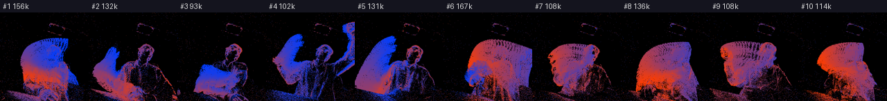
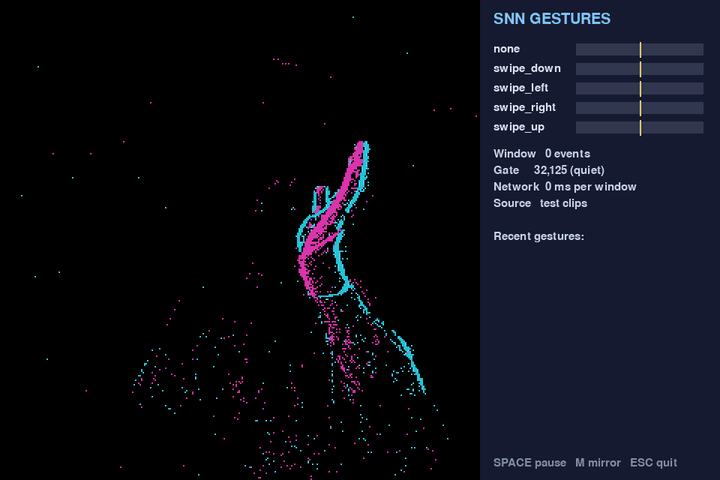
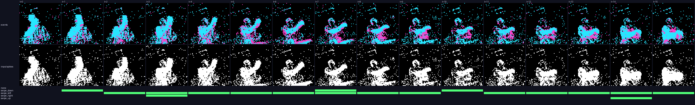
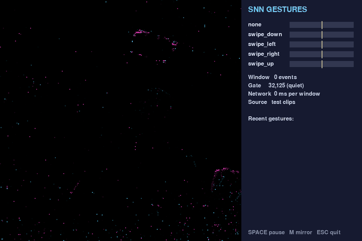
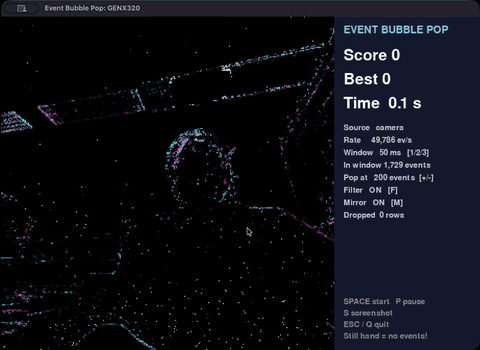

# Hand gestures with an event camera and a spiking neural network

> This isn't research. We built these demos for fun and for the class, so don't expect benchmarks or careful experiments here.

If you've never played with an event camera, here's the quick version: there are no frames. Each pixel speaks up on its own whenever the brightness it sees changes, and sends an event saying where, when (down to the microsecond), and whether it got brighter (*ON*) or darker (*OFF*). Swipe your hand past the sensor and you get about 100,000 events in 1.5 seconds. Sit still and you get around 20,000, and most of those are just sensor noise.

For the [Event Sensor Course](https://esc.e3computing.org/) by E3Computing Group, we wanted something fun that goes all the way from camera to "the computer knows I swiped left." So we built two small open-source demos. Both record events with an OpenMV GENX320 event camera on an H7 Plus board, train a convolutional spiking neural network (CSNN) with [SpikingJelly](https://github.com/fangwei123456/spikingjelly), and then detect hand swipes live:

- [gesture_recognition_genx320_spikesum](https://github.com/EventSensorCourse/gesture_recognition_genx320_spikesum) gives the network event *counts*.
- [gesture_recognition_genx320_spike-event](https://github.com/EventSensorCourse/gesture_recognition_genx320_spike-event) gives it the events themselves, as binary spikes.

Both use the same data, network and live detector. They differ only in how the events get turned into network input.

## The data

The recorder is a little guided app. It tells you what to do (`swipe_left`, `swipe_right`, `swipe_up`, `swipe_down`, or `none`, which means sit still), shouts **GO!**, and keeps exactly 1.5 s of events, timed with the sensor's own clock. Both repositories come with an example dataset of 100 clips: 20 per class, one person (me), one session, split 70 / 15 / 15 into train, valid and test.



*Ten `swipe_left` clips and their event counts, anywhere from 93k to 167k per clip. You only see the moving hand and arm, because the still background never changes and so never fires.*

## Demo 1: summing the spikes

The first demo counts. Every event is treated as a spike, and the spikes get added up: the clip is cut into 16 time steps of 94 ms, the 320 × 320 sensor is shrunk to 64 × 64 blocks of 5 × 5 pixels, and ON and OFF go into separate channels. Each count is then squashed with `log(1 + count)`. What the network sees is a `[16, 2, 64, 64]` tensor of real numbers between 0 and about 5, and its first layer of LIF (leaky integrate-and-fire) neurons turns those into spikes.



*`detect_gestures.py` replaying held-out test clips. Cyan is ON, magenta is OFF, and the panel shows how often each output neuron is firing.*

## Demo 2: events go straight in as spikes

The second demo skips the counting. An input neuron spikes (1) in a time step if *any* event landed in its 5 × 5 block, and stays at 0 if none did. ON and OFF get merged. So the input is a `[16, 1, 64, 64]` tensor of zeros and ones, and the whole network, input to output, runs on nothing but spikes. That's the kind of input a neuromorphic chip wants, which is why we were curious about it.

You do throw some things away doing this. Exact timing inside a 94 ms step is gone. So is the count, since 1 event or 50 events in a block both make one spike. Polarity is gone too. On the example data, an average training clip of 105,886 events shrinks to 10,249 input spikes, roughly 10 %.



*One `swipe_left` test clip over 16 steps. Top row: the events. Middle row: the input spikes the network actually gets. Bottom row: spikes from the five output neurons. `swipe_left` fires in 13 of the 16 steps and wins. Made with `show_spikes.py`.*

I like how quiet the network is: only 3 to 12 % of the convolution neurons fire in any given step. And you can see that nothing comes out in step 0, because the membrane potentials start at zero and need a step to charge up.



*`detect_spikes.py` replaying test clips: one still clip and one swipe in each direction, all called correctly.*

## The network and the live detector

Both demos share the same CSNN. There are three convolution blocks (`Conv 3×3 > BatchNorm > LIF > MaxPool`) with 16, 32 and 64 channels, then a hidden layer of 128 neurons, then five output LIF neurons, one per class. That's about 550k parameters. Whichever output neuron fires most often is the answer. Training uses a surrogate gradient and backpropagation through time over the 16 steps, and on a laptop CPU an epoch over 70 clips takes about 1 to 1.5 s. No GPU needed.

For live detection, every 100 ms (sensor time) the detector grabs the last 1.5 s of events and runs the network from fresh neurons. It only calls a gesture if the window has clearly more events than a still scene, the same class wins two windows in a row, and enough time has passed since the last gesture. Otherwise one swipe would get reported over and over.

## How did they do?

On the example dataset (one person, one session, T = 16):

| Check | Summed spikes | Events as spikes |
|---|---|---|
| Input | `[16, 2, 64, 64]`, log counts | `[16, 1, 64, 64]`, 0/1 |
| Best valid accuracy | 100 % | 100 % (got there sooner, at epoch 16) |
| Test accuracy | 15 / 15 | 14 / 15 (one `swipe_down` called `swipe_left`) |
| Replayed test gestures | 12 / 12, 0 false alarms | 11 / 12, 0 false alarms |

That's a difference of one test clip, so I wouldn't read much into it. If I had to bet, I'd blame the missing polarity: ON and OFF edges tell you which side of the hand is getting brighter, and that's handy for telling directions apart. Also, take all these numbers with a big grain of salt. Every clip is me, in one session, and there are only three test clips per class. We haven't measured live accuracy yet.

## Try it yourself

Both repositories ship with the example data and pretrained weights, so you can play with everything without owning a camera:

```sh
git clone https://github.com/EventSensorCourse/gesture_recognition_genx320_spike-event.git
cd gesture_recognition_genx320_spike-event
python3.12 -m venv .venv && source .venv/bin/activate
python -m pip install -r requirements.txt

python show_spikes.py                                                  # follow one clip through the network
python detect_spikes.py --model pretrained/spike_csnn.pt --clips test  # replay test clips, no board needed
```

If you do have an OpenMV H7 Plus and a GENX320, record your own session with `gesture_recorder.py`, retrain, and point the detector at the live camera. A few things I'd try next: add polarity back as a second input channel, only let a block spike once it sees at least *k* events, or train with 32 or 64 time steps and see what changes.

## Bonus: a bubble pop game

The gesture demos take some work before anything happens: you record, you train, and then you detect. For a quicker feel of what the sensor sees, we also made [event_bubble_pop](https://github.com/EventSensorCourse/event_bubble_pop), a small game for the same GENX320 and H7 Plus. Bubbles float up over the live event view, and you pop them by waving your hand through them. If a bubble reaches the top, the game is over. Holding your hand still inside a bubble does nothing, because a still hand makes no events.



*Playing with the live camera. The side panel shows the score, the incoming event rate, and how many events a bubble needs to pop.*

There's no neural network in this one. The game cuts the stream into 50 ms windows of sensor time, removes isolated events (real edges are connected, sensor noise is scattered), and counts the events inside each bubble. A bubble pops once it collects 200 events in a window. If too many pixels fire at once, the game assumes the room light changed and pops nothing.

Fast waving ran into a limit of the USB link. The H7 Plus talks to the computer at USB Full-Speed, and in OpenMV's default Processed format, which spends 12 bytes on each event, that tops out at about 69k events/s. A waving hand produces more. With 8 buffers on the board, the extra events queued up and the display fell up to about 700 ms behind the hand. The game now uses 2 buffers, so the board drops the extra events instead of queuing them, and it streams the raw EVT2.0 format at about 4 bytes per event. With a hand waving the whole time, that got about 174k events/s through with a median delay of 3 ms.

To play, no training needed:

```sh
git clone https://github.com/EventSensorCourse/event_bubble_pop.git
cd event_bubble_pop
python3.12 -m venv .venv && source .venv/bin/activate
python -m pip install -r requirements.txt

python bubble_pop.py                          # live camera, press SPACE to start
python bubble_pop.py --replay recording.csv   # no board: play a recorded CSV
```

The game also works as a template for your own event-camera project: keep `event_stream.py`, and swap the processing in `process_window()` for your own algorithm.

All three projects are MIT licensed, so go wild.
